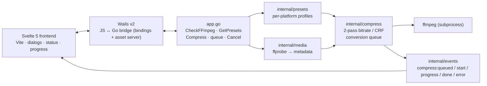
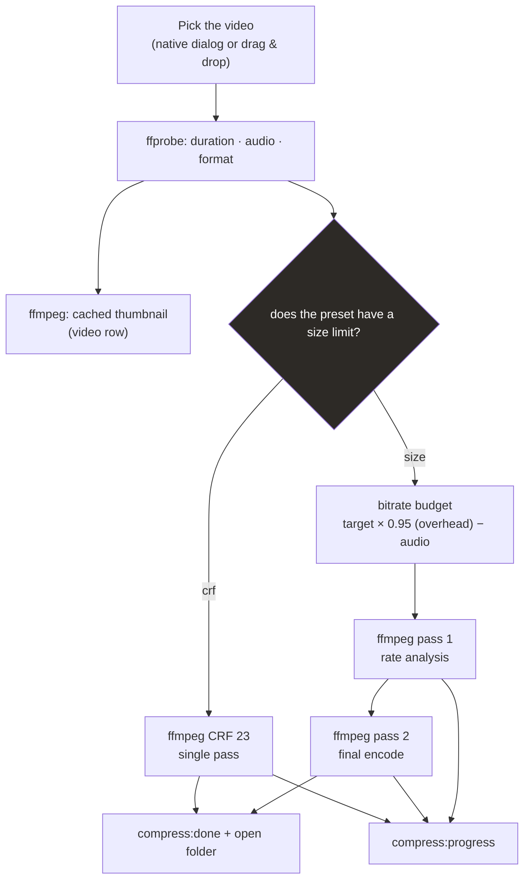
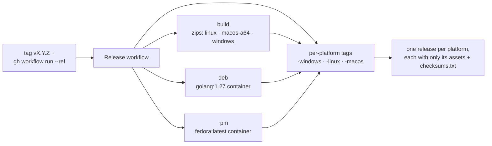

# vidctl

**English · [Português (Brasil)](../README.md) · [Español](README.es.md) ·
[中文（简体）](README.zh-CN.md)**

Desktop video compressor with a Go backend (Wails + ffmpeg). Pick a destination
(WhatsApp, Instagram, Shorts, YouTube) and the app automatically derives the
bitrate to hit the target size — keeping duration and format intact, without
cutting the scene. Powered by **2-pass** encoding when there is a size limit or
**CRF** when quality comes first, with optional **H.265/HEVC** and **GPU
acceleration** (NVENC/QSV/AMF/VideoToolbox) and **per-file adjustments** (scale,
cut, remove audio, FPS, rotation, thumbnail). 100% offline.

> Version history: [CHANGELOG.md](../CHANGELOG.md)

## Features

- Exact presets per platform (WhatsApp 10/16 MB, Instagram 16 MB, Shorts 30 MB,
  YouTube CRF, or a free size you define) — plus you can create your own presets
  ("create preset" in the Presets section)
- **Cut**: splits the video by time — N equal parts or X minutes per part
  (e.g., 30 min → 6 × 5 min) — with at least 1 min per part; each part is
  compressed independently and saved as `name-part1.mp4`, … The `min/part`
  accepts fractions (e.g., `1.5` = 1 m 30 s) and the counters offer an editable
  field + **Shift** arrow keys for fine control
- **Task queue**: compressing and extracting audio share the same queue, which
  processes **one job at a time** (sequential); each item shows status, progress
  and cancellation, with "clear queue" for finished ones. There is a single
  current video — **"Switch video…"** replaces the selection without enqueueing
  a batch
- **Drag and drop**: on the empty screen, drag a video into the window or use
  "Open…" — the selection area becomes a highlighted target on hover. With a
  video loaded, drop a new file anywhere in the window (or use **"Switch
  video…"**) to replace the selection
- **H.265 codec and GPU acceleration**: in the "Advanced" card you switch
  H.264 ↔ H.265 and pick the encoder per job — NVENC, QSV, AMF or VideoToolbox —
  with automatic detection (1-frame probe) and, on NVENC, a
  speed/quality preset `p1`–`p7`
- **Video adjustments**: scale (default/original/custom), window cut in `mm:ss`,
  remove audio, FPS, rotation and thumbnail generation — applied per job, on top
  of the preset
- **Extract audio**: the **"Extract audio"** section of the sidebar pulls the
  audio track without re-encoding the video, choosing format
  (mp3/opus/aac/flac/wav or copy), quality, channels and normalization — the
  extraction joins the same task queue
- **Collapsible sidebar + conversion time**: configuration groups collapse and
  expand (accordion, one at a time) and every conversion shows elapsed and total
  time when done, making it easy to compare presets and encoders
- ffmpeg **2-pass** encoding to hit the max size without blowing the limit
- **Quality warning before compressing**: the app estimates the bitrate the
  current settings will produce (per part when cutting); if it falls below what
  the resolution needs, it suggests the ideal size target or cut with one click
- Real-time progress with cancellation at any time
- Progress panel below the video with system load readings (CPU, memory, ffmpeg
  process and NVIDIA GPU when available)
- Native desktop for **Linux, Windows and macOS** (Wails v2 +
  WebKit/WebView2), opening in a **1360×768** window by default
- Light/dark theme: **"System"** follows the real desktop theme (reads GTK on
  Linux, `AppleInterfaceStyle` on macOS and the registry on Windows — WebKit
  does not always report the right theme), and you can pin light/dark with the
  sun/moon button at the top (the choice persists between runs)
- **Constrict**-style visuals: matte dark theme with slate accent, derived light
  theme and a custom icon in the installers of every platform
- No internet: fonts and UI bundled in the binary
- Checks `ffmpeg`/`ffprobe` at startup and warns when they are missing; the
  "check again" button re-reads the system PATH, so you can install ffmpeg with
  the app open without restarting
- **Persistent configuration**: preset, size, CRF and destination folder come
  back as they were on the next boot; you can point ffmpeg/ffprobe outside the
  PATH in Preferences
- **System notifications**: a desktop alert when a task finishes or fails, and
  an option to open the output file folder automatically on success — both
  toggles live in Preferences
- **Update check**: on launch the app queries GitHub and, if a newer version
  exists, shows a badge in the top bar ("v2.6.0 available") linking to the
  release; the refresh button re-runs the check. Offline is not an error — it
  just shows nothing
- On Windows, conversions and file probing do not open console windows

## Installation

Download from the [releases page](https://github.com/fabianoflorentino/vidctl/releases)
the latest tag ending in your system — vidctl publishes **one release per
platform**:

| Release tag | Packages |
|---|---|
| `v1.x.y-windows` | `vidctl-windows-x64.zip` + checksums |
| `v1.x.y-macos` | `vidctl-macos-arm64.zip` + checksums |
| `v1.x.y-linux` | zip + `.deb` + `.rpm` + checksums |

Step-by-step guide, with integrity verification and per-system ffmpeg:
**[instalacao.md](instalacao.md)**

## How it works

### Architecture



### Compression pipeline



### Automatic distribution



**One release per platform**: a **vX.Y.Z** tag (e.g., `v2.0.0`) publishes three
releases (`vX.Y.Z-windows`, `vX.Y.Z-linux`, `vX.Y.Z-macos`), each with only its
system's binaries (Linux carries zip + deb + rpm). The suffix-less `vX.Y.Z` tag
is the source of the tarball used by the PKGBUILD (Arch/AUR).

## Configuration

Preferences live in `config.json`, inside the user configuration folder:

| System | Path |
|---|---|
| Linux | `~/.config/vidctl/config.json` |
| macOS | `~/Library/Application Support/vidctl/config.json` |
| Windows | `%AppData%\vidctl\config.json` |

The file is written atomically (temp + `rename`), so a crash mid-write does not
corrupt the preferences. If the file is missing or invalid, the app opens with
the default values instead of failing.

| Field | Default | What it does |
|---|---|---|
| `presetId` | `whatsapp-status` | preset selected in the sidebar |
| `sizeMB` | `10` | MB target for size presets |
| `crf` | `23` | CRF for quality presets |
| `outputDir` | empty | destination folder; empty = next to the source video |
| `ffmpegPath` | empty | ffmpeg path; empty = look up the PATH |
| `ffprobePath` | empty | ffprobe path; empty = look up the PATH |
| `language` | `pt` | interface language (used from the i18n phase on) |
| `maxParallel` | `1` | how many videos to compress at once (queue) |
| `notifyOnDone` | `false` | notify when finished |
| `openFolderOnDone` | `false` | open the output folder when finished |

`maxParallel` applies to the conversion queue (applied at startup and when
saving Preferences); `notifyOnDone` and `openFolderOnDone` control the
[notifications](#notifications). `language` keeps the interface language
chosen in Preferences.

You can also edit the file by hand: out-of-range values (CRF above 51,
`maxParallel` below 1) are fixed on read, and everything else is preserved,
including fields from future versions.

### Binaries outside the PATH

If ffmpeg is not on the PATH — or you want a specific build — open
**Preferences** and fill in `ffmpeg` and/or `ffprobe`. The configured path takes
precedence over the PATH and applies immediately, without a restart. A path that
does not exist is reported as an error instead of silently falling back to the
PATH binary, and the "check again" button confirms the result.

## Presets (destination → size/quality)

| Platform | Mode | Target |
|---|---|---|
| WhatsApp Status | 2-pass | 10 MB |
| WhatsApp (document) | 2-pass | 16 MB |
| Instagram Reels / Stories | 2-pass | 16 MB |
| YouTube Shorts | 2-pass | 30 MB |
| YouTube (regular video) | CRF 23 | no limit |
| Custom size | 2-pass | user-defined |

### Custom presets

On top of the built-ins, you can **create your own presets**: the **Presets**
section of the sidebar has a **"create preset"** button — name, mode (size in MB
or CRF), audio bitrate, codec (H.264/H.265) and encoder
(software/NVENC/AMF/QSV/VideoToolbox). A selected custom preset shows the
**"edit"** button (and can be deleted from the modal). They are saved in
`presets.json` in the configuration folder (same atomic write as `config.json`),
get `custom-` IDs and are listed like any other preset — including in the
quality/estimate safeguards.

## Size estimate

Before compressing, vidctl shows in the "Size" panel the size the output should
have (badge "expected ≈ X MB") and the saving compared to the original file,
whenever the target is smaller. In `size` mode the forecast is exact: it uses the
same bit budget as the 2-pass encode (target × 0.95 overhead − audio, with a
per-part budget when cutting), so the real result lands within a few percentage
points of the expectation on content that fills the budget. In CRF mode there is
still no deterministic forecast and the badge does not appear.

## Codecs and GPU acceleration

In step 02, the **"Advanced"** card switches the video codec and encoder for
that job, without changing the saved preset:

| Option | Encoder | 2-pass (size) | Size control |
|---|---|---|---|
| Software (CPU) | `libx264` / `libx265` | ✅ | ✅ precise |
| NVIDIA NVENC | `h264_nvenc` / `hevc_nvenc` | ❌ | 1-pass VBR (±5–10%) |
| Intel QSV | `h264_qsv` / `hevc_qsv` | ✅ | ✅ |
| AMD AMF | `h264_amf` / `hevc_amf` | ❌ | 1-pass VBR (±5–10%) |
| Apple VideoToolbox | `h264_videotoolbox` / `hevc_videotoolbox` | ❌ | 1-pass VBR |

- **Software stays the default**: the 2-pass in `size` mode is the only path with
  an exact size forecast (the panel estimate uses the same budget). GPU
  acceleration is much faster and frees the CPU, but usually needs ~20–30% more
  bitrate to match software quality — that is why the UI warns when a GPU
  encoder is active and `size` mode can vary by ±5–10% from the target.
- **H.265 ≠ GPU**: HEVC shrinks the file at the same quality (or improves
  quality at the same size), but in software it is *slower* than H.264. The real
  speed gain comes from hardware, not the codec.
- **"Automatic"** enables the first detected hardware backend
  (NVENC → QSV → AMF → VideoToolbox), falling back to software if none work.
- **Detection**: the app lists the encoders of your `ffmpeg`
  (`ffmpeg -hide_banner -encoders`, cached) and runs a 1-frame probe (`256×256`)
  to confirm the GPU driver works. Backends that fail appear disabled with the
  reason in the UI; "check again" in the card re-detects (e.g., after installing
  the driver).
- **Per platform**: **AMF** (AMD) is only offered on Windows and **VideoToolbox**
  only on macOS (they are platform-specific APIs). NVENC and QSV are detected on
  any OS where `ffmpeg` lists them.
- **GPU in the progress panel**: the "GPU %" shows the maximum between the
  graphics and **video** engines (`utilization.gpu` vs `utilization.encoder`). An
  NVENC encode raises the encoder engine, not the graphics bar — if you monitor
  with `nvtop`/`nvidia-smi`, watch the **ENC** column (or the "GPU %" of the
  panel), not the main bar.
- **NVENC preset**: with the NVIDIA encoder active, the "Advanced" card lets you
  change the preset `p1`–`p7` per job (default `p4`). `p1`/`p2` almost double the
  encode speed — the video engine stays saturated anyway; `p7` prioritizes
  quality. The trade-off is light in size mode (compression efficiency).

## Cut (split by time)

In the sidebar, the **"Cut"** group splits the video before compressing — useful
when the destination has a size/duration limit (e.g., a 60 s status) or when you
want to publish the content sliced.

| Field | Rule |
|---|---|
| **N parts** | the video is divided into N equal segments (e.g., 30 min → 6 × 5 min) |
| **min/part** | fixed-duration segments (accepts fractions: `1.5` = 1 m 30 s); the remainder becomes a final part if ≥ 1 min, otherwise it is joined to the last one |
| Minimum | 1 minute per part — cuts that make a smaller part are blocked |
| Maximum | 60 parts per video |

Each part goes through the chosen compression pipeline (preset/size/CRF) and
produces a `output-partN.mp4` file (index padded with leading zeros when there
are 10+ parts). The progress shows `part X/N` and, at the end, the app
summarizes the total saving over the original file.

## Video adjustments

The **"Video adjustments"** group applies extra controls to the video *after*
the preset, also per job:

| Control | Behavior |
|---|---|
| **Scale** | **Default** caps at 1280px on the longer side (normal behavior); **Original** keeps the source resolution (no scale filter); **Custom** uses `WIDTHxHEIGHT` (e.g., `1280x720`) preserving the aspect ratio |
| **Cut** | `start`/`end` in `mm:ss` keep **one window** of the video (e.g., only 1:00–3:30), with seek before decode (`-ss/-to` before `-i`); the size budget and the progress consider the cut duration |
| **Remove audio** | output without an audio track (`-an` / no `-c:a`) |
| **FPS** | overrides the frames per second (`fps=<N>`); `0` keeps the source |
| **Orientation** | rotates 90°, 180° or 270° (`transpose`, applied before the scale) |
| **Thumbnail** | after the encode, extracts one frame of the output to the chosen file (`ffmpeg -ss <mid> -frames:v 1`) |

The video filter order is always `transpose → scale → fps`. Manual cut and
**"Cut"** cannot be combined. Accepted time formats: `90` (seconds), `1:30`
(minutes:seconds) and `1:02:30` (hours).

## Extract audio

The extraction **options** live in the **"Extract audio"** section of the
sidebar (format, quality, channels, normalization and window); the **extract
button** sits on the video card, in a box just like the destination (below the
"Save as…"), showing the audio path with the chosen format's extension. Without
re-encoding the video:

| Option | Detail |
|---|---|
| **Format** | `mp3`, `opus`, `aac`, `flac`, `wav` or **copy** (stream copy, remux to `.mka` without re-encoding) |
| **Quality** | `kbps` for lossy formats (32–320); `flac`/`wav`/`copy` do not accept bitrate — they come out lossless |
| **Channels** | keep, mono (`-ac 1`) or stereo (`-ac 2`) |
| **Normalize** | `-af loudnorm=I=-16:LRA=11:TP=-1.5` (EBU R128, single-pass); not applicable to `copy` |
| **Window** | extracts only the `start`–`end` range in `mm:ss` (e.g., `1:30`–`3:00`), with seek before decode |

- The destination is automatic, in the preferred folder or next to the video,
  with the **suffix** from Preferences (default `-audio`): `invite-audio.mp3`.
  The audio box under the video destination shows that path (with the selected
  format's extension, e.g., `invite-audio.flac`), plus the **"extract audio"**
  button and a **"Save as…"** to choose another destination.
- The extraction joins the **same task queue** (`Task.Kind = audio`): it uses the
  same events, shows progress (`EXTRACTING AUDIO`) and can be canceled; when
  done, the item gains "open folder".
- Videos **without an audio track** do not show the action and, if attempted,
  fail with "the video has no audio track".

## Task queue

vidctl works on **one video at a time**: "Switch video…" (or dragging a new file
into the window) replaces the current selection and **resets the per-file
options** to default (cut, split, scale and adjustments). Every operation —
compress or extract audio — joins the same **task queue**, which processes
**one at a time** (sequential).

The queue appears below the video with name, type (compression/audio extract),
status and a progress bar for the running item, and lets you cancel item by item
or **clear the queue** (removes finished, failed and canceled items).

- How many jobs run at once comes from `maxParallel` in `config.json` (default
  **1** = sequential); edit the file and reopen the app for it to take effect.
  With the default, compression and audio extraction never compete for CPU.
- "Switch video…" uses the picked video as the new target (same behavior as the
  ⋮ → "switch file"); the queue gains no extra work when switching.
- Progress is per job (`compress:queued`, `compress:start`,
  `compress:progress`, `compress:done`, `compress:error`), so an error in one
  item does not bring the others down. Every job shows **conversion time**:
  elapsed during processing and total when done — useful for comparing presets
  and encoders.

## Notifications

In **Preferences**, the **Notifications** section controls what happens when a
queue task finishes:

- **Notify when finished** (`notifyOnDone`): shows a system notification —
  "finished" or "failed" — when a compression or audio extraction comes to an
  end.
- **Open folder on done** (`openFolderOnDone`): reveals the output video
  folder in the file manager when the task finishes successfully.

Notifications use the native notifier of each platform (toast on Windows,
Notification Center on macOS, `notify-send` on Linux) and never affect the
conversion result: a desktop without a notifier simply ignores the alert.

## Update check

vidctl checks, on launch, whether a newer release exists on the
[releases page](https://github.com/fabianoflorentino/vidctl/releases):
- Whenever a new version exists, the **badge** (e.g. `v2.6.0 available`)
  appears in the top bar, next to Preferences; clicking it opens the release in
  the browser.
- The **refresh** icon (arrows) in the same bar re-runs the check at any time.
- The check hits the public GitHub API with a 5 s timeout and a **per-session
  cache**; offline, timeout or HTTP errors are silent (`Ok=false`) — the app
  never freezes or blocks boot because of the update check.

## Usability

- **Collapsible sidebar**: the configuration cards (`Size`/`Quality`, `Advanced`,
  `Presets`, `Cut`, `Extract audio`, `Video adjustments`) collapse and expand by
  their header; `Advanced`, `Cut`, `Extract audio` and `Video adjustments` come
  closed by default.
- **Drag and drop**: the whole window accepts dropping a video at any time — on
  the empty screen there is a selection area with "open video…", and with a
  video loaded the top target was removed (the action-bar button **"Switch
  video…"** already replaces it, and a file dropped in the window substitutes the
  input and resets the per-file adjustments).

## Stack

- **Backend:** Go 1.25+ (Wails v2.16.0, ffmpeg/ffprobe)
- **Frontend:** Svelte 5 + Vite, with bundled fonts (works offline)

## Prerequisites (development)

- Go 1.25+
- Node.js 22+
- Wails CLI: `go install github.com/wailsapp/wails/v2/cmd/wails@v2.16.0`
- ffmpeg and ffprobe on the `PATH`
- Linux: GTK/WebKit development packages
  - Debian/Ubuntu: `libgtk-3-dev libwebkit2gtk-4.1-dev`
  - old-code architectures (`webkit2gtk-4.0`) have no dedicated build tag

## Development

```bash
wails dev -tags webkit2_41
```

The `webkit2_41` tag is needed on Linux when the system only has WebKitGTK 4.1.
On macOS/Windows it can be omitted.

### Local debugging

To trace the pipeline in the compiled binary (queue, progress events and JS
errors), turn on diagnostic mode:

```bash
make build
VIDCTL_DEBUG=1 ./build/bin/vidctl
```

The terminal receives, with timestamps, every queue transition (enqueue, start,
worker finish), every event emitted to the UI and every event received in the
frontend — including patches discarded by state — plus JavaScript exceptions.
Without `VIDCTL_DEBUG` the log stays off, at no cost.

External commands run and the pipeline decision are also traced:

- `[compress] plugin …` — summary of each segment: mode, encoders
  (`encoder=hevc_nvenc`, etc.), hardware, 2-pass, `-vf` chain, seek (cut/split),
  audio removal, FPS, rotation, thumbnail and output.
- `[compress] … exec ffmpeg …` — the full `ffmpeg` command (passes, single-pass
  and thumbnail), reproducible line by line.
- `[media] exec ffprobe/ffmpeg …` — file probe and thumbnail generation.
- `[encode] exec ffmpeg …` — encoder listing (`-encoders`) and the 1-frame probe
  per backend, with the `OK`/`unavailable` result and the reason.

## Production build

```bash
wails build -clean -tags webkit2_41
```

The binary comes out at `build/bin/vidctl`.

## Tests

```bash
go test ./...
make cover        # measures coverage (% per function and total)
```

CI runs the tests with the race detector and requires coverage of **>= 80%**
(`go test -race -shuffle=on -count=1 ./...` + gate in GitHub Actions).

Manual smoke test against a real file (does a 2-pass encode and checks the size):

```bash
VIDCTL_SMOKE="/path/to/video.mp4" go test -run TestSmokeReal -v ./internal/compress/
```

## Project structure

```text
.
├── main.go                    # Wails entrypoint + window options
├── internal/
│   ├── app/                     # Wails binding facade (dialogs, compress, queue, config)
│   ├── cmdutil/                 # subprocess creation and binary lookup (with PATH override)
│   ├── compress/                # ffmpeg pipeline: bitrate budget, 2-pass and CRF, job management
│   ├── config/                  # preferences persisted in config.json (atomic read/write)
│   ├── events/                  # backend → frontend events (progress/done/error)
│   ├── media/                   # metadata via ffprobe and thumbnails via ffmpeg
│   ├── notify/                  # desktop notifications (beeep — toast/Notification Center/notify-send)
│   ├── presets/                 # per-platform profiles (WhatsApp, Instagram, Shorts, YouTube)
│   ├── split/                   # part-cut plan (N parts or min/part)
│   ├── sysinfo/                 # CPU/memory/GPU usage for the progress panel
│   └── systemtheme/             # per-OS light/dark system theme detection
├── frontend/                    # Svelte 5 + Vite UI (bindings in frontend/wailsjs)
├── pkg/
│   ├── aur/                     # PKGBUILD + scripts (AUR-style install)
│   ├── arch/                    # pkg/arch/install.sh (makepkg -si)
│   ├── deb/ · rpm/              # .deb and .rpm package descriptors
│   └── icon/ · vidctl.desktop
├── docs/                        # README/CHANGELOG in 4 languages, install guide, backlog, plans
├── site/                        # static landing page (Pages)
├── build/                       # Wails build assets (icon, darwin/windows)
├── .github/workflows/           # CI · Release (zips + deb + rpm) · Pages
└── Makefile                     # dev, build, run, test, check, smoke, clean
```