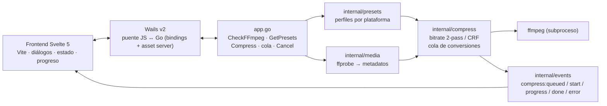
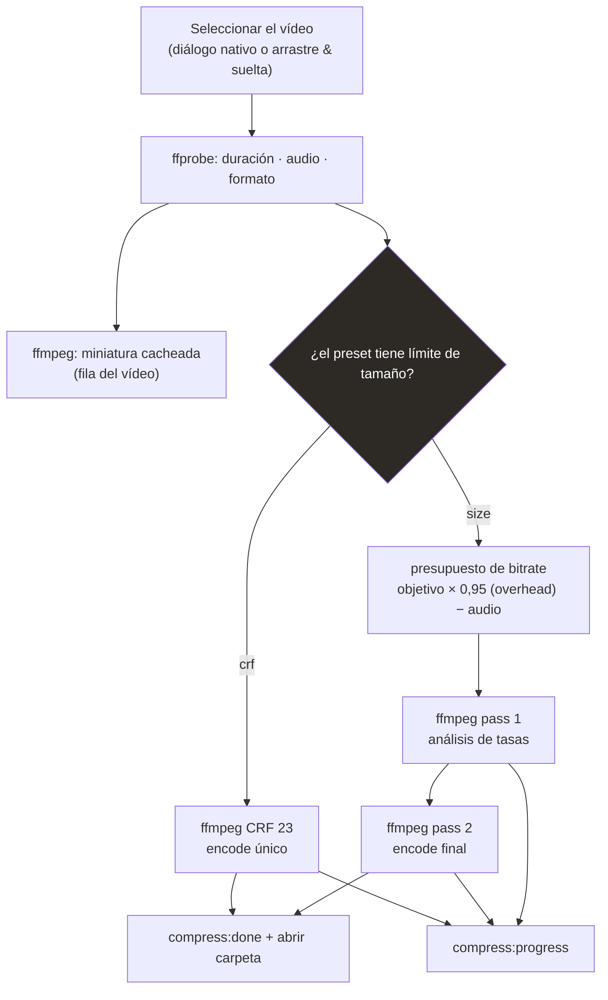
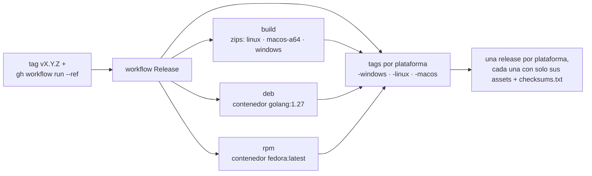

# vidctl

**Español · [Português (Brasil)](../README.md) · [English](README.en.md) ·
[中文（简体）](README.zh-CN.md)**

Compresor de vídeo de escritorio con backend Go (Wails + ffmpeg). Elige un
destino (WhatsApp, Instagram, Shorts, YouTube) y la app calcula automáticamente el
bitrate para caber en el tamaño objetivo — conservando duración y formato, sin
cortar la escena. Alimentado por encode **2-pass** cuando hay límite de tamaño o
**CRF** cuando la calidad es lo primero, con **H.265/HEVC** y **aceleración de
GPU** opcionales (NVENC/QSV/AMF/VideoToolbox) y **ajustes por archivo** (escala,
corte, quitar audio, FPS, rotación, thumbnail). 100 % offline.

> Historial de versiones: [CHANGELOG.md](../CHANGELOG.md)

## Funciones

- Presets exactos por plataforma (WhatsApp 10/16 MB, Instagram 16 MB, Shorts 30 MB,
  YouTube CRF, o un tamaño libre que definas tú) — y puedes crear tus propios
  presets ("crear preset" en la sección Presets)
- **Cortar**: divide el vídeo por tiempo — N partes iguales o X minutos por parte
  (ej.: 30 min → 6 × 5 min); cada parte se comprime de forma independiente y se
  guarda como `nombre-part1.mp4`, … El sobrante se convierte en la última parte
  aunque dure menos de 1 min (ej.: 1:49 → 1:00 + 0:49), y el total de partes está
  limitado a 60. El `min/parte` acepta fracciones (ej.: `1.5` = 1 m 30 s) y los
  contadores tienen campo editable + flechas con **Shift** para ajuste fino
- **Cola de tareas**: comprimir y extraer audio comparten la misma cola, que
  procesa **un trabajo a la vez** (secuencial); cada elemento muestra estado,
  progreso y cancelación, con "vaciar cola" para los terminados. Hay un único
  vídeo actual — **"Cambiar vídeo…"** reemplaza la selección sin encolar lote
- **Arrastrar y soltar**: en la pantalla vacía, arrastra un vídeo a la ventana o
  usa "Abrir…" — el área de selección se vuelve un objetivo resaltado al pasar
  por encima. Con vídeo cargado, suelta un archivo nuevo en cualquier parte de la
  ventana (o usa **"Cambiar vídeo…"**) para reemplazar la selección
- **Códec H.265 y aceleración de GPU**: en la tarjeta "Avanzado" cambias
  H.264 ↔ H.265 y eliges el codificador por trabajo — NVENC, QSV, AMF o
  VideoToolbox — con detección automática (prueba de 1 frame) y, en NVENC, un
  preset de velocidad/calidad `p1`–`p7`
- **Ajustes de vídeo**: escala (predeterminado/original/personalizada), corte por
  ventana en `mm:ss`, quitar audio, FPS, rotación y generación de thumbnail —
  aplicados por trabajo, además del preset
- **Extraer audio**: la sección **"Extraer audio"** de la barra lateral toma la
  pista de audio sin recodificar el vídeo, eligiendo formato
  (mp3/opus/aac/flac/wav o copiar), calidad, canales y normalización — la
  extracción entra a la misma cola de tareas
- **Transcripción local (SRT/VTT + texto)**: desde el menú del vídeo
  ("transcribir vídeo…") la app genera subtítulos `.srt`/`.vtt` y texto plano
  `.txt` con un motor **offline** instalado en la máquina (whisper.cpp o vosk) —
  nada sale a la nube; elige idioma, formato, timestamps por palabra y ventana
- **Sidebar colapsable + tiempo de conversión**: los grupos de configuración
  colapsan y expanden (acordeón, uno a la vez) y cada conversión muestra el
  tiempo transcurrido y el total al terminar, facilitando comparar presets y
  codificadores
- Encode ffmpeg **2-pass** para alcanzar el tamaño máximo sin pasar el límite
- **Aviso de calidad antes de comprimir**: la app estima el bitrate que el
  ajuste actual va a producir (por parte cuando hay corte); si queda por debajo
  de lo ideal para la resolución, sugiere el objetivo en MB o el corte ideales
  con un clic
- Progreso en tiempo real con cancelación en cualquier momento
- Panel de progreso bajo el vídeo con lecturas de carga del sistema (CPU,
  memoria, proceso de ffmpeg y GPU NVIDIA cuando está disponible)
- Escritorio nativo para **Linux, Windows y macOS** (Wails v2 + WebKit/WebView2),
  abre en una ventana de **1360×768** por defecto
- Tema claro/oscuro: **"Sistema"** sigue el tema real del escritorio (lee GTK en
  Linux, `AppleInterfaceStyle` en macOS y el registro en Windows — WebKit no
  siempre reporta el tema correcto), y puedes fijar claro/oscuro en las
  **Preferencias** (la elección persiste entre ejecuciones)
- Visual estilo **Constrict**: tema oscuro mate con accent slate, tema claro
  derivado e ícono propio en los instaladores de todas las plataformas
- Sin internet: fuentes e interfaz empaquetadas en el binario
- Verifica `ffmpeg`/`ffprobe` al inicio y avisa si faltan; el botón "volver a
  comprobar" relee el PATH del sistema, así que puedes instalar ffmpeg con la app
  abierta sin reiniciar
- **Configuración persistente**: preset, tamaño, CRF y carpeta de destino
  vuelven como estaban al siguiente inicio; puedes apuntar ffmpeg/ffprobe fuera
  del PATH en Preferencias
- **Notificaciones del sistema**: aviso del escritorio cuando una tarea termina
  o falla, y opción de abrir automáticamente la carpeta del archivo de salida
  al finalizar — los dos interruptores están en Preferencias
- **Verificación de actualización**: al abrir, la app consulta GitHub y muestra
  el estado en las **Preferencias** (nueva versión, actualizado, versión local
  desconocida u offline) con enlace a la release; la comprobación puede
  repetirse. Estar offline no es un error — solo significa que no se pudo
  comprobar
- En Windows, las conversiones y las sondas de archivo no abren ventanas de
  consola

## Instalación

Descarga de la [página de releases](https://github.com/fabianoflorentino/vidctl/releases)
la tag más reciente que termine en tu sistema — vidctl publica **una release por
plataforma**:

| Tag de release | Paquetes |
|---|---|
| `v1.x.y-windows` | `vidctl-windows-x64.zip` + checksums |
| `v1.x.y-macos` | `vidctl-macos-arm64.zip` + checksums |
| `v1.x.y-linux` | zip + `.deb` + `.rpm` + checksums |

Guía paso a paso, con verificación de integridad y el ffmpeg por sistema:
**[instalacao.md](instalacao.md)**

## Cómo funciona

### Arquitectura



### Pipeline de compresión



### Distribución automática



**Una release por plataforma**: una tag **vX.Y.Z** (ej.: `v2.0.0`) publica tres
releases (`vX.Y.Z-windows`, `vX.Y.Z-linux`, `vX.Y.Z-macos`), cada una con solo
los binarios de su sistema (Linux lleva zip + deb + rpm). La tag `vX.Y.Z` sin
sufijo es la fuente del tarball usado por el PKGBUILD (Arch/AUR).

## Configuración

Las preferencias viven en `config.json`, dentro de la carpeta de configuración
del usuario:

| Sistema | Ruta |
|---|---|
| Linux | `~/.config/vidctl/config.json` |
| macOS | `~/Library/Application Support/vidctl/config.json` |
| Windows | `%AppData%\vidctl\config.json` |

El archivo se escribe de forma atómica (temporal + `rename`), así que una caída a
mitad de escritura no corrompe las preferencias. Si el archivo falta o está
inválido, la app abre con los valores predeterminados en lugar de fallar.

| Campo | Predeterminado | Qué hace |
|---|---|---|
| `presetId` | `whatsapp-status` | preset seleccionado en la sidebar |
| `sizeMB` | `10` | objetivo en MB de los presets de tamaño |
| `crf` | `23` | CRF de los presets de calidad |
| `outputDir` | vacío | carpeta de destino; vacío = junto al vídeo original |
| `ffmpegPath` | vacío | ruta de ffmpeg; vacío = buscar en el PATH |
| `ffprobePath` | vacío | ruta de ffprobe; vacío = buscar en el PATH |
| `language` | `pt` | idioma de la interfaz (usado desde la fase de i18n) |
| `maxParallel` | `1` | cuántos vídeos comprimir a la vez (cola) |
| `notifyOnDone` | `false` | notificar al terminar |
| `openFolderOnDone` | `false` | abrir la carpeta de salida al terminar |

`maxParallel` aplica a la cola de conversiones (aplicado al inicio y al guardar
Preferencias); `notifyOnDone` y `openFolderOnDone` controlan las
[notificaciones](#notificaciones). `language` conserva el idioma elegido en la
interfaz.

También puedes editar el archivo a mano: los valores fuera de rango (CRF sobre
51, `maxParallel` bajo 1) se corrigen al leer, y el resto se conserva, incluidos
campos de versiones futuras.

### Binarios fuera del PATH

Si ffmpeg no está en el PATH — o quieres una build concreta — abre
**Preferencias** y rellena `ffmpeg` y/o `ffprobe`. La ruta configurada tiene
prioridad sobre el PATH y aplica de inmediato, sin reiniciar. Una ruta que no
existe se reporta como error en vez de caer silenciosamente al binario del PATH,
y el botón "volver a comprobar" confirma el resultado.

## Presets (destino → tamaño/calidad)

| Plataforma | Modo | Objetivo |
|---|---|---|
| WhatsApp Status | 2-pass | 10 MB |
| WhatsApp (documento) | 2-pass | 16 MB |
| Instagram Reels / Stories | 2-pass | 16 MB |
| YouTube Shorts | 2-pass | 30 MB |
| YouTube (vídeo normal) | CRF 23 | sin límite |
| Tamaño personalizado | 2-pass | definido por el usuario |

### Presets personalizados

Además de los fijos, puedes **crear tus propios presets**: en la sección
**Presets** de la barra lateral está el botón **"crear preset"** — nombre, modo
(tamaño en MB o CRF), bitrate de audio, códec (H.264/H.265) y codificador
(software/NVENC/AMF/QSV/VideoToolbox). Un preset custom seleccionado muestra el
botón **"editar"** (y se puede eliminar desde el modal). Se guardan en
`presets.json` en la carpeta de configuración (misma escritura atómica del
`config.json`), reciben IDs `custom-` y entran en la lista como cualquier otro —
incluso en los avisos de calidad/estimación.

## Estimación de tamaño

Antes de comprimir, vidctl muestra en el panel "Tamaño" el tamaño que debe tener
la salida (badge "esperado ≈ X MB") y el ahorro frente al archivo original,
cuando el objetivo es menor. En modo `size` la previsión es exacta: usa el mismo
presupuesto de bits del encode 2-pass (objetivo × 0,95 de overhead − audio, con
un presupuesto por parte en cortes), así que el resultado real queda a pocos
puntos porcentuales de lo esperado en contenido que llena el presupuesto. En modo
CRF aún no hay previsión determinística y el badge no aparece.

## Códecs y aceleración de GPU

En el paso 02, la tarjeta **"Avanzado"** cambia el códec de vídeo y el codificador
para ese trabajo, sin alterar el preset guardado:

| Opción | Codificador | 2-pass (tamaño) | Control de tamaño |
|---|---|---|---|
| Software (CPU) | `libx264` / `libx265` | ✅ | ✅ preciso |
| NVIDIA NVENC | `h264_nvenc` / `hevc_nvenc` | ❌ | VBR 1-pass (±5–10 %) |
| Intel QSV | `h264_qsv` / `hevc_qsv` | ✅ | ✅ |
| AMD AMF | `h264_amf` / `hevc_amf` | ❌ | VBR 1-pass (±5–10 %) |
| Apple VideoToolbox | `h264_videotoolbox` / `hevc_videotoolbox` | ❌ | VBR 1-pass |

- **El software sigue siendo el predeterminado**: el 2-pass del modo `size` es el
  único camino con previsión exacta de tamaño (la estimación del panel usa el
  mismo presupuesto). La aceleración de GPU es mucho más rápida y libera la CPU,
  pero suele exigir ~20–30 % más bitrate para igualar la calidad del software —
  por eso la UI avisa cuando un codificador de GPU está activo y el modo `size`
  puede variar ±5–10 % del objetivo.
- **H.265 ≠ GPU**: HEVC encoge el archivo con la misma calidad (o mejora la
  calidad con el mismo tamaño), pero en software es *más lento* que H.264. La
  ganancia real de velocidad viene del hardware, no del códec.
- **"Automático"** activa el primer backend de hardware detectado
  (NVENC → QSV → AMF → VideoToolbox), con fallback a software si ninguno
  funciona.
- **Detección**: la app lista los codificadores de tu `ffmpeg`
  (`ffmpeg -hide_banner -encoders`, en caché) y ejecuta una prueba de 1 frame
  (`256×256`) para confirmar que el driver de la GPU funciona. Los backends que
  fallan aparecen deshabilitados con el motivo en la UI; "volver a comprobar" en
  la tarjeta re-detecta (ej.: después de instalar el driver).
- **Por plataforma**: **AMF** (AMD) solo se ofrece en Windows y **VideoToolbox**
  solo en macOS (son APIs específicas de esos sistemas). NVENC y QSV se detectan
  en cualquier SO donde `ffmpeg` los liste.
- **GPU en el panel de progreso**: el "GPU %" muestra el máximo entre la engine
  gráfica y la de **vídeo** (`utilization.gpu` vs `utilization.encoder`). Un
  encode NVENC sube la engine de encoder, no la barra de gráficos — si sigues por
  `nvtop`/`nvidia-smi`, observa la columna **ENC** (o el "GPU %" del panel), no la
  barra principal.
- **Preset NVENC**: con el codificador NVIDIA activo, la tarjeta "Avanzado" deja
  cambiar el preset `p1`–`p7` por trabajo (predeterminado `p4`). `p1`/`p2` casi
  duplican la velocidad de encode — la engine de vídeo queda saturada de todas
  formas; `p7` prioriza la calidad. El trade-off es leve en modo tamaño
  (eficiencia de compresión).

## Cortar (split por tiempo)

En la barra lateral, el grupo **"Cortar"** divide el vídeo antes de comprimir —
útil cuando el destino tiene límite de tamaño/duración (ej.: un estado de 60 s) o
cuando quieres publicar el contenido en tajadas.

| Campo | Regla |
|---|---|
| **N partes** | el vídeo se divide en N tramos iguales (ej.: 30 min → 6 × 5 min) |
| **min/parte** | tramos con duración fija (acepta fracciones: `1.5` = 1 m 30 s); el sobrante se vuelve la última parte aunque dure menos de 1 min (ej.: 1:49 → 1:00 + 0:49) |
| Máximo | 60 partes por vídeo |

Cada parte pasa por el pipeline de compresión elegido (preset/tamaño/CRF) y
genera un archivo `salida-partN.mp4` (índice con cero a la izquierda cuando hay
10+ partes). El progreso muestra `parte X/N` y, al final, la app resume el ahorro
total sobre el archivo original.

## Ajustes de vídeo

El grupo **"Ajustes de vídeo"** aplica controles extra al vídeo *después* del
preset, también por trabajo:

| Control | Comportamiento |
|---|---|
| **Escala** | **Predeterminado** limita a 1280px en el lado mayor (comportamiento normal); **Original** mantiene la resolución de la fuente (sin filtro de escala); **Personalizado** usa `ANCHOxALTO` (ej.: `1280x720`) conservando la proporción |
| **Corte** | `inicio`/`fin` en `mm:ss` guardan **una ventana** del vídeo (ej.: solo el tramo 1:00–3:30), con seek antes del decode (`-ss/-to` antes de `-i`); el presupuesto de tamaño y el progreso consideran la duración cortada |
| **Quitar audio** | salida sin pista de audio (`-an` / sin `-c:a`) |
| **FPS** | sobrescribe los cuadros por segundo (`fps=<N>`); `0` mantiene el de la fuente |
| **Orientación** | gira 90°, 180° o 270° (`transpose`, aplicado antes de la escala) |
| **Thumbnail** | tras el encode, extrae un frame del vídeo de salida al archivo elegido (`ffmpeg -ss <medio> -frames:v 1`) |

El orden de los filtros de vídeo es siempre `transpose → scale → fps`. El corte
manual y **"Cortar"** no se pueden combinar. Formatos de tiempo aceptados: `90`
(segundos), `1:30` (minutos:segundos) y `1:02:30` (horas).

## Extraer audio

Las **opciones** de extracción viven en la sección **"Extraer audio"** de la
barra lateral (formato, calidad, canales, normalización y ventana); el **botón de
extraer** está en la tarjeta del vídeo, en una caja igual a la del destino (bajo
el "Guardar como…"), mostrando la ruta del audio con la extensión del formato
elegido. Sin recodificar el vídeo:

| Opción | Detalle |
|---|---|
| **Formato** | `mp3`, `opus`, `aac`, `flac`, `wav` o **copiar** (stream copy, remux a `.mka` sin recodificar) |
| **Calidad** | `kbps` para formatos con pérdida (32–320); `flac`/`wav`/`copiar` no aceptan bitrate — salen sin pérdida |
| **Canales** | mantener, mono (`-ac 1`) o estéreo (`-ac 2`) |
| **Normalizar** | `-af loudnorm=I=-16:LRA=11:TP=-1.5` (EBU R128, single-pass); no aplica a `copiar` |
| **Ventana** | extrae solo el tramo `inicio`–`fin` en `mm:ss` (ej.: `1:30`–`3:00`), con seek antes del decode |

- El destino es automático, en la carpeta preferida o junto al vídeo, con el
  **sufijo** de Preferencias (predeterminado `-audio`): `invitacion-audio.mp3`.
  La caja de audio bajo el destino del vídeo muestra esa ruta (con la extensión
  del formato elegido, ej.: `invitacion-audio.flac`), además del botón
  **"extraer audio"** y un **"Guardar como…"** para elegir otro destino.
- La extracción entra a la **misma cola de tareas** (`Task.Kind = audio`): usa
  los mismos eventos, muestra progreso (`EXTRAYENDO AUDIO`) y permite cancelar;
  al terminar, el elemento gana "abrir carpeta".
- Los vídeos **sin pista de audio** no muestran la acción y, si se intentan,
  fallan con "el vídeo no tiene pista de audio".

## Transcripción (subtítulos SRT/VTT + texto)

Desde el menú del vídeo (**⋮ → "transcribir vídeo…"**) la app abre el modal de
transcripción. El audio se extrae a PCM 16 kHz mono y se entrega a un motor de
**speech-to-text local**; nada se envía a la nube. La salida son archivos
`.srt`, `.vtt` y/o `.txt` junto al vídeo (sufijo por defecto `-transcript`).

| Opción | Detalle |
|---|---|
| **Motor** | `auto` detecta; `whisper.cpp` (binario `whisper-cli`) o `vosk` (`vosk-transcriber`) |
| **Modelo** | ruta al modelo local (`ggml-*.bin` en whisper; carpeta/idioma en vosk). No se descarga nada — tú indicas el archivo |
| **Idioma** | `auto`, `pt` o `en` |
| **Formato** | `all` (srt+vtt+txt), `srt`, `vtt` o `txt` |
| **Timestamps por palabra** | un subtítulo por palabra (solo SRT/VTT; el TXT lo ignora) |
| **Ventana** | transcribe solo el tramo `inicio`–`fin` en `mm:ss` (ej.: `0:30`–`2:00`) |

- **Privacidad por defecto**: solo motores locales. Sin ninguno instalado, la
  app avisa (nunca sugiere una API en la nube) y la compresión sigue funcionando.
- Instala `whisper-cli` (whisper.cpp) o `vosk-transcriber`; modelos ligeros
  sugeridos (`tiny`/`base`/`small`) — ver `docs/instalacao.md`.
- La transcripción entra en la **misma cola** (`Task.Kind = transcribe`):
  progreso, cancelación y "abrir carpeta" en el elemento terminado. Los vídeos
  sin audio fallan con "el vídeo no tiene pista de audio".

## Cola de tareas

vidctl trabaja sobre **un vídeo a la vez**: "Cambiar vídeo…" (o arrastrar un
archivo nuevo a la ventana) reemplaza la selección actual y **reinicia las
opciones por archivo** al predeterminado (corte, división en partes, escala y
ajustes). Cada operación — comprimir o extraer audio — entra a la misma **cola de
tareas**, que procesa **una a la vez** (secuencial).

La cola aparece bajo el vídeo con nombre, tipo (compresión/extracción de audio),
estado y barra de progreso del elemento en ejecución, y permite cancelar elemento
a elemento o **vaciar cola** (quita terminados, errores y cancelados).

- Cuántos trabajos corren a la vez viene de `maxParallel` en `config.json`
  (predeterminado **1** = secuencial); edita el archivo y reabre la app para que
  valga. Con el predeterminado, compresión y extracción de audio nunca pelean por
  CPU.
- "Cambiar vídeo…" usa el vídeo elegido como el nuevo objetivo (mismo
  comportamiento del ⋮ → "cambiar archivo"); la cola no gana trabajo extra al
  cambiar.
- El progreso es por trabajo (`compress:queued`, `compress:start`,
  `compress:progress`, `compress:done`, `compress:error`), así que un error en un
  elemento no tumba a los demás. Cada trabajo muestra el **tiempo de conversión**:
  transcurrido durante el proceso y total al terminar — útil para comparar
  presets y codificadores.

## Notificaciones

En **Preferencias**, la sección **Notificaciones** controla lo que ocurre
cuando una tarea de la cola termina:

- **Avisar al finalizar** (`notifyOnDone`): muestra una notificación del
  sistema — "finalizado" o "falló" — cuando una compresión o extracción de
  audio llega a su fin.
- **Abrir carpeta al finalizar** (`openFolderOnDone`): revela en el gestor de
  archivos la carpeta del vídeo de salida cuando la tarea termina con éxito.

Las notificaciones usan el sistema nativo de cada plataforma (toast en Windows,
Notification Center en macOS, `notify-send` en Linux) y nunca interfieren con el
resultado de la conversión: un escritorio sin notificador simplemente ignora el
aviso.

## Verificación de actualización

El vidctl comprueba al abrir si hay una release más reciente en la
[página de releases](https://github.com/fabianoflorentino/vidctl/releases):
- El estado aparece en las **Preferencias** (botón en la esquina superior
  derecha): **comprobando**, **nueva versión disponible** con
  el número de versión (y un botón para abrir la release), **vidctl está
  actualizado**, **versión local desconocida** (build sin versión incorporada)
  o **sin conexión**.
- El botón **verificar** repite la comprobación en cualquier momento.
- La verificación consulta la API pública de GitHub con un timeout de 5 s y
  **caché por sesión**; offline, timeout o error HTTP son silenciosos
  (`Ok=false`) — la app nunca se congela ni bloquea el arranque por la
  actualización.

## Usabilidad

## Usabilidad

- **Sidebar colapsable**: las tarjetas de configuración (`Tamaño`/`Calidad`,
  `Avanzado`, `Presets`, `Cortar`, `Extraer audio`, `Ajustes de vídeo`) colapsan y
  expanden por su cabecera; `Avanzado`, `Cortar`, `Extraer audio` y `Ajustes de
  vídeo` vienen cerrados por defecto.
- **Arrastrar y soltar**: la ventana entera acepta soltar un vídeo en cualquier
  momento — en la pantalla vacía hay un área de selección con "abrir vídeo…", y
  con el vídeo cargado el objetivo superior se eliminó (el botón de la barra de
  acciones **"Cambiar vídeo…"** ya hace el cambio, y un archivo soltado en la
  ventana sustituye la entrada y reinicia los ajustes por archivo).

## Stack

- **Backend:** Go 1.25+ (Wails v2.16.0, ffmpeg/ffprobe)
- **Frontend:** Svelte 5 + Vite, con fuentes empaquetadas (funciona offline)

## Prerrequisitos (desarrollo)

- Go 1.25+
- Node.js 22+
- Wails CLI: `go install github.com/wailsapp/wails/v2/cmd/wails@v2.16.0`
- ffmpeg y ffprobe en el `PATH`
- Linux: paquetes de desarrollo GTK/WebKit
  - Debian/Ubuntu: `libgtk-3-dev libwebkit2gtk-4.1-dev`
  - arquitecturas de código antiguo (`webkit2gtk-4.0`) no tienen tag de build
    propia

## Desarrollo

```bash
wails dev -tags webkit2_41
```

La tag `webkit2_41` es necesaria en Linux cuando el sistema solo tiene WebKitGTK
4.1. En macOS/Windows se puede omitir.

### Depuración local

Para rastrear el pipeline en el binario compilado (cola, eventos de progreso y
errores de JS), activa el modo de diagnóstico:

```bash
make build
VIDCTL_DEBUG=1 ./build/bin/vidctl
```

El terminal recibe, con timestamp, cada transición de la cola (encolar, iniciar,
fin del worker), cada evento emitido a la UI y cada evento recibido en el
frontend — incluidos los patches descartados por estado — además de las
excepciones de JavaScript. Sin `VIDCTL_DEBUG` el log queda apagado, sin costo.

También se rastrean los comandos externos ejecutados y la decisión del pipeline:

- `[compress] plugin …` — resumen de cada segmento: modo, codificadores
  (`encoder=hevc_nvenc`, etc.), hardware, 2-pass, cadena `-vf`, seek (corte/split),
  remoción de audio, FPS, rotación, thumbnail y salida.
- `[compress] … exec ffmpeg …` — comando `ffmpeg` completo (passes, single-pass y
  thumbnail), reproducible línea a línea.
- `[media] exec ffprobe/ffmpeg …` — sonda del archivo y generación de miniatura.
- `[encode] exec ffmpeg …` — listado de codificadores (`-encoders`) y la sonda de
  1 frame por backend, con el resultado `OK`/`indisponible` y el motivo.

## Build de producción

```bash
wails build -clean -tags webkit2_41
```

El binario sale en `build/bin/vidctl`.

## Tests

```bash
go test ./...
make cover        # mide cobertura (% por función y total)
```

El CI ejecuta los tests con race detector y exige cobertura de **>= 80 %**
(`go test -race -shuffle=on -count=1 ./...` + gate en GitHub Actions).

Smoke test manual contra un archivo real (hace un encode 2-pass y chequea el
tamaño):

```bash
VIDCTL_SMOKE="/ruta/al/video.mp4" go test -run TestSmokeReal -v ./internal/compress/
```

## Estructura del proyecto

```text
.
├── main.go                    # entrypoint Wails + opciones de la ventana
├── internal/
│   ├── app/                     # fachada de bindings del Wails (diálogos, compress, cola, config)
│   ├── cmdutil/                 # creación de subprocesos y búsqueda de binarios (con override del PATH)
│   ├── compress/                # pipeline ffmpeg: presupuesto de bitrate, 2-pass y CRF, gestión de jobs
│   ├── config/                  # preferencias persistidas en config.json (lectura/escritura atómica)
│   ├── events/                  # eventos backend → frontend (progress/done/error)
│   ├── media/                   # lectura de metadatos vía ffprobe y miniaturas vía ffmpeg
│   ├── notify/                  # notificaciones del escritorio (beeep — toast/Centro de notificaciones/notify-send)
│   ├── presets/                 # perfiles por plataforma (WhatsApp, Instagram, Shorts, YouTube)
│   ├── split/                   # plan de corte en partes (N partes o min/parte)
│   ├── sysinfo/                 # uso de CPU/memoria/GPU para el panel de progreso
│   └── systemtheme/             # detección del tema claro/oscuro del sistema por SO
├── frontend/                    # UI Svelte 5 + Vite (bindings en frontend/wailsjs)
├── pkg/
│   ├── aur/                     # PKGBUILD + scripts (instalación estilo AUR)
│   ├── arch/                    # pkg/arch/install.sh (makepkg -si)
│   ├── deb/ · rpm/              # descriptores de los paquetes .deb y .rpm
│   └── icon/ · vidctl.desktop
├── docs/                        # README/CHANGELOG en 4 idiomas, instalación, backlog y planes
├── site/                        # landing page estática (Pages)
├── build/                       # recursos de build del Wails (ícono, darwin/windows)
├── .github/workflows/           # CI · Release (zips + deb + rpm) · Pages
└── Makefile                     # dev, build, run, test, check, smoke, clean
```