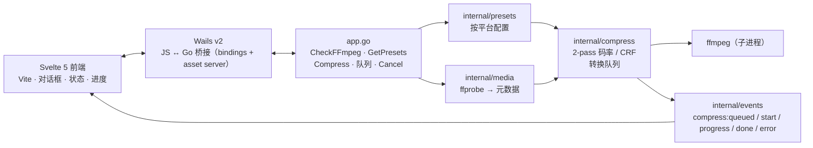
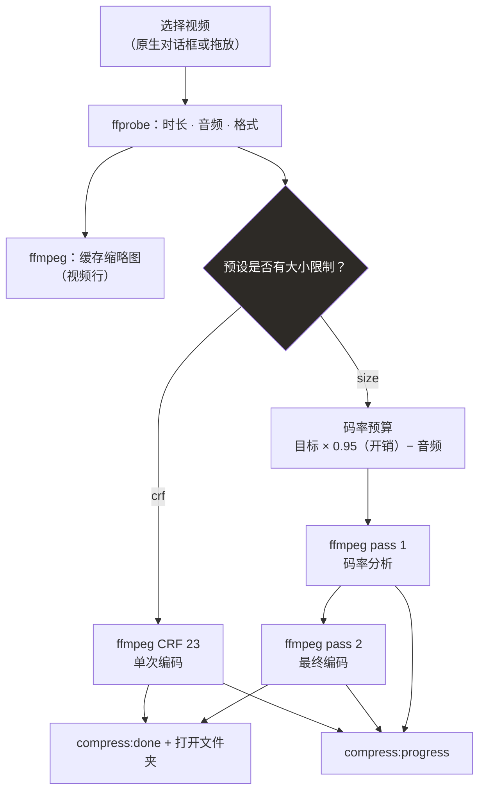
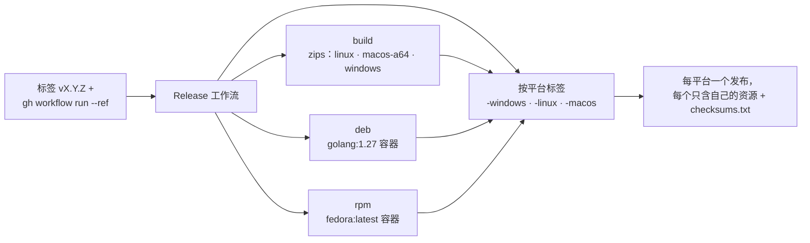

# vidctl

**中文（简体）· [Português (Brasil)](../README.md) · [English](README.en.md) ·
[Español](README.es.md)**

使用 Go 后端的桌面视频压缩工具（Wails + ffmpeg）。选择一个目标
（WhatsApp、Instagram、Shorts、YouTube），应用会自动推导码率以命中目标大小 —
保留时长和格式，不裁剪画面。当有大小限制时使用 **2-pass** 编码，质量优先时使用
**CRF**，并支持可选的 **H.265/HEVC**、**GPU 加速**（NVENC/QSV/AMF/VideoToolbox）、
**按文件调整**（缩放、裁剪、移除音频、FPS、旋转、缩略图）。100% 离线。

> 版本历史：[CHANGELOG.md](../CHANGELOG.md)

## 功能

- 按平台提供精确预设（WhatsApp 10/16 MB、Instagram 16 MB、Shorts 30 MB、YouTube CRF，或由你定义的自定义大小）——还可以在“预设”区域创建你自己的预设（“创建预设”）
- **切割**：按时间分割视频 — N 等分或每段 X 分钟（例：30 分钟 → 6 × 5 分钟）；每段独立压缩并保存为 `名称-part1.mp4` 等。余下部分会成为最后一段，即使不足 1 分钟（例：1:49 → 1:00 + 0:49），段数上限为 60。`每段分钟` 支持小数（例：`1.5` = 1 分 30 秒），计数器提供可编辑字段 + **Shift** 方向键微调
- **任务队列**：压缩和提取音频共用同一个队列，**一次只处理一个任务**（串行）；每个项目显示状态、进度和取消，并提供“清空队列”清除已完成项。每次只处理一个当前视频 — **“切换视频…”** 替换当前选择，不会批量入队
- **拖放**：在空屏时，将视频拖入窗口或用“打开…” — 悬停时选择区域会变成高亮目标。加载视频后，在窗口任意位置放下新文件（或使用 **“切换视频…”**）即可替换选择
- **H.265 编解码与 GPU 加速**：在“高级”卡片中切换 H.264 ↔ H.265，并为每个任务选择编码器 — NVENC、QSV、AMF 或 VideoToolbox — 带自动检测（1 帧探测）和 NVENC 速度/质量预设 `p1`–`p7`
- **视频调整**：缩放（默认/原始/自定义）、`mm:ss` 窗口裁剪、移除音频、FPS、旋转和生成缩略图 — 在预设基础上按任务应用
- **提取音频**：侧边栏的 **“提取音频”** 部分无需重新编码即可提取音轨，可选择格式（mp3/opus/aac/flac/wav 或复制）、质量、声道和标准化 — 提取进入同一个任务队列
- **本地转写（SRT/VTT + 文本）**：通过视频菜单（“转写视频…”）应用使用机器上安装的 **离线** 引擎（whisper.cpp 或 vosk）生成 `.srt`/`.vtt` 字幕和纯文本 `.txt` — 不上传云端；可选择语言、格式、逐词时间戳和时间窗口
- **可折叠侧栏 + 转换用时**：配置分组可折叠与展开（手风琴，每次一个），每次转换都会显示已用时间和最终用时，方便对比预设和编码器
- ffmpeg **2-pass** 编码，精确命中最大大小且不超出限制
- **压缩前质量提示**：应用会估算当前设置将产生的码率（切割时按每段）；若低于分辨率所需，会一键建议合适的 MB 目标或切割方式
- 实时进度，随时可取消
- 视频下方进度面板显示系统负载（CPU、内存、ffmpeg 进程和 NVIDIA GPU，可用时）
- 支持 **Linux、Windows、macOS** 原生桌面（Wails v2 + WebKit/WebView2），默认 **1360×768** 窗口
- 浅色/深色主题：**“系统”** 跟随真实桌面主题（Linux 读取 GTK，macOS 读取 `AppleInterfaceStyle`，Windows 读取注册表 — WebKit 并不总能正确报告主题），也可以在**“设置”**中固定浅色/深色（选择在运行之间保留）
- **Constrict** 风格视觉：哑光深色主题配石板蓝强调色、派生浅色主题，以及所有平台安装包中的自定义图标
- 无需联网：字体和界面打包在二进制中
- 启动时检查 `ffmpeg`/`ffprobe` 并在缺失时提示；“重新检查”按钮会重新读取系统 PATH，因此可以在应用打开时安装 ffmpeg，无需重启
- **持久化配置**：预设、大小、CRF 和输出文件夹在下一次启动时恢复原样；也可以在“设置”中将 ffmpeg/ffprobe 指向 PATH 之外的位置
- **系统通知**：任务完成或失败时发出桌面通知，并可在成功时自动打开输出文件所在文件夹 —— 两个开关都位于“设置”中
- **更新检查**：启动时应用会查询 GitHub，并在**“设置”**中显示状态（有新版本、已是最新、本地版本未知或离线）并提供发布页链接；可随时重新检查。离线不算错误 —— 只是无法检查
- 在 Windows 上，转换和文件探测不会打开控制台窗口

## 安装

从[发布页面](https://github.com/fabianoflorentino/vidctl/releases)下载以你所在系统为后缀的最新标签 — vidctl **每个平台发布一个版本**：

| 发布标签 | 软件包 |
|---|---|
| `v1.x.y-windows` | `vidctl-windows-x64.zip` + 校验和 |
| `v1.x.y-macos` | `vidctl-macos-arm64.zip` + 校验和 |
| `v1.x.y-linux` | zip + `.deb` + `.rpm` + 校验和 |

包含完整性校验和各系统 ffmpeg 的分步指南：**[instalacao.md](instalacao.md)**

## 工作原理

### 架构



### 压缩流程



### 自动发布



**每平台一个发布**：一个 **vX.Y.Z** 标签（例：`v2.0.0`）会发布三个版本
（`vX.Y.Z-windows`、`vX.Y.Z-linux`、`vX.Y.Z-macos`），每个只含其系统的二进制
（Linux 携带 zip + deb + rpm）。不带后缀的 `vX.Y.Z` 标签是 PKGBUILD
（Arch/AUR）所用 tarball 的来源。

## 配置

偏好设置保存在用户配置目录下的 `config.json` 中：

| 系统 | 路径 |
|---|---|
| Linux | `~/.config/vidctl/config.json` |
| macOS | `~/Library/Application Support/vidctl/config.json` |
| Windows | `%AppData%\vidctl\config.json` |

文件采用原子写入（临时文件 + `rename`），因此写入中途崩溃不会损坏偏好设置。如果文件缺失或无效，应用会以默认值打开而不是失败。

| 字段 | 默认值 | 作用 |
|---|---|---|
| `presetId` | `whatsapp-status` | 侧栏中选中的预设 |
| `sizeMB` | `10` | 大小预设的 MB 目标 |
| `crf` | `23` | 质量预设的 CRF |
| `outputDir` | 空 | 输出文件夹；为空 = 与源视频同目录 |
| `ffmpegPath` | 空 | ffmpeg 路径；为空 = 在 PATH 中查找 |
| `ffprobePath` | 空 | ffprobe 路径；为空 = 在 PATH 中查找 |
| `language` | `pt` | 界面语言（从 i18n 阶段起生效） |
| `maxParallel` | `1` | 同时压缩多少个视频（队列） |
| `notifyOnDone` | `false` | 完成时通知 |
| `openFolderOnDone` | `false` | 完成时打开输出文件夹 |

`maxParallel` 已经作用于转换队列（启动和保存“设置”时应用）；`notifyOnDone` 和
`openFolderOnDone` 控制[通知](#通知)。`language` 保留界面中选择的语言。

你也可以手动编辑文件：越界值（CRF 超过 51、`maxParallel` 低于 1）会在读取时修正，其余内容（包括未来版本的字段）都会保留。

### PATH 之外的二进制

如果 ffmpeg 不在 PATH 中 — 或者你想要特定构建 — 打开 **设置** 并填写 `ffmpeg` 和/或 `ffprobe`。配置的路径优先于 PATH 并立即生效，无需重启。不存在的路径会报错，而不是静默回退到 PATH 中的二进制；“重新检查”按钮可确认结果。

## 预设（目标 → 大小/质量）

| 平台 | 模式 | 目标 |
|---|---|---|
| WhatsApp 状态 | 2-pass | 10 MB |
| WhatsApp（文档） | 2-pass | 16 MB |
| Instagram Reels / Stories | 2-pass | 16 MB |
| YouTube Shorts | 2-pass | 30 MB |
| YouTube（普通视频） | CRF 23 | 无限制 |
| 自定义大小 | 2-pass | 由用户定义 |

### 自定义预设

除内置预设之外，你还可以**创建自己的预设**：侧边栏的“预设”区域有一个
**“创建预设”** 按钮——名称、模式（按 MB 或 CRF）、音频码率、编码（H.264/H.265）
与编码器（软件/NVENC/AMF/QSV/VideoToolbox）。选中的自定义预设会显示
**“编辑”** 按钮（也可以在弹窗中删除）。它们保存在配置文件夹的
`presets.json` 中（与 `config.json` 相同的原子写入方式），获得 `custom-`
前缀的 ID，并像其他预设一样出现在列表中——包括质量/大小估算提示在内。

## 大小估算

压缩前，vidctl 会在“大小”面板中显示输出应有的大小（徽标“预计 ≈ X MB”）以及相对原始文件的节省（当目标更小时）。在 `size` 模式下预测是精确的：它使用与 2-pass 编码相同的比特预算（目标 × 0.95 开销 − 音频，切割时每段一个预算），因此对于填满预算的内容，实际结果与预期只差几个百分点。CRF 模式目前还没有确定性预测，徽标不会出现。

## 编解码器与 GPU 加速

在步骤 02，**“高级”** 卡片可为该任务切换视频编解码器和编码器，而不改变已保存的预设：

| 选项 | 编码器 | 2-pass（大小） | 大小控制 |
|---|---|---|---|
| 软件（CPU） | `libx264` / `libx265` | ✅ | ✅ 精确 |
| NVIDIA NVENC | `h264_nvenc` / `hevc_nvenc` | ❌ | 1-pass VBR（±5–10%） |
| Intel QSV | `h264_qsv` / `hevc_qsv` | ✅ | ✅ |
| AMD AMF | `h264_amf` / `hevc_amf` | ❌ | 1-pass VBR（±5–10%） |
| Apple VideoToolbox | `h264_videotoolbox` / `hevc_videotoolbox` | ❌ | 1-pass VBR |

- **软件仍是默认**：`size` 模式下的 2-pass 是唯一能精确预测大小的路径（面板估算使用同一预算）。GPU 加速更快并释放 CPU，但通常需要多 ~20–30% 的码率才能匹配软件质量 — 因此当 GPU 编码器激活时 UI 会提示，`size` 模式可能偏离目标 ±5–10%。
- **H.265 ≠ GPU**：HEVC 在相同质量下体积更小（或在相同大小下质量更好），但在软件中它比 H.264 *更慢*。真正的速度增益来自硬件，而非编解码器。
- **“自动”** 会启用第一个检测到的硬件后端（NVENC → QSV → AMF → VideoToolbox），若都不可用则回退到软件。
- **检测**：应用列出你的 `ffmpeg` 的编码器（`ffmpeg -hide_banner -encoders`，带缓存）并运行 1 帧探测（`256×256`）以确认 GPU 驱动可用。失败的端点在 UI 中显示为禁用并附原因；卡片中的“重新检查”会重新检测（例如安装驱动后）。
- **按平台**：**AMF**（AMD）仅在 Windows 提供，**VideoToolbox** 仅在 macOS 提供（它们是平台特定 API）。NVENC 和 QSV 可在列出它们的任何操作系统上检测到。
- **进度面板中的 GPU**：“GPU %” 显示图形引擎和**视频**引擎（`utilization.gpu` vs `utilization.encoder`）中的最大值。NVENC 编码会提升编码器引擎，而不是图形条 — 如果使用 `nvtop`/`nvidia-smi` 监控，请观察 **ENC** 列（或面板的“GPU %”），而不是主条。
- **NVENC 预设**：启用 NVIDIA 编码器时，“高级”卡片可为每个任务更改预设 `p1`–`p7`（默认 `p4`）。`p1`/`p2` 几乎让编码速度快一倍 — 视频引擎无论如何都会饱和；`p7` 优先质量。在大小模式下权衡很轻（压缩效率）。

## 切割（按时长分割）

在侧边栏中，**“切割”** 分组会在压缩前分割视频 — 当目标有大小/时长限制（例如 60 秒状态）或你想分段发布内容时很有用。

| 字段 | 规则 |
|---|---|
| **N 段** | 视频分为 N 个相等的片段（例：30 分钟 → 6 × 5 分钟） |
| **每段分钟** | 固定时长的片段（支持小数：`1.5` = 1 分 30 秒）；余下部分会成为末段，即使不足 1 分钟（例：1:49 → 1:00 + 0:49） |
| 最大 | 每个视频最多 60 段 |

每个片段都会经过所选压缩流程（预设/大小/CRF），并生成 `输出-partN.mp4` 文件（10 段以上时索引补零）。进度显示 `片段 X/N`，最后应用会汇总相对原始文件的总节省。

## 视频调整

**“视频调整”** 分组会在预设*之后*为视频应用额外控制，也是按任务：

| 控制 | 行为 |
|---|---|
| **缩放** | **默认**将长边限制为 1280px（正常行为）；**原始**保留源分辨率（不添加缩放滤镜）；**自定义**使用 `宽x高`（例如 `1280x720`）并保持宽高比 |
| **裁剪** | `开始`/`结束`（`mm:ss`）保留视频的**一个窗口**（例如仅 1:00–3:30），解码前 seek（`-ss/-to` 在 `-i` 之前）；大小预算和进度都会考虑裁剪后的时长 |
| **移除音频** | 输出不带音轨（`-an` / 无 `-c:a`） |
| **FPS** | 覆盖每秒帧数（`fps=<N>`）；`0` 保留源帧率 |
| **方向** | 旋转 90°、180° 或 270°（`transpose`，在缩放之前应用） |
| **缩略图** | 编码后从输出中提取一帧到所选文件（`ffmpeg -ss <中间> -frames:v 1`） |

视频滤镜顺序始终为 `transpose → scale → fps`。手动裁剪和**“切割”**不能同时使用。接受的时间格式：`90`（秒）、`1:30`（分钟:秒）和 `1:02:30`（小时）。

## 提取音频

提取**选项**位于侧边栏的 **“提取音频”** 部分（格式、质量、声道、标准化和窗口）；**提取按钮**位于视频卡片上，在一个与输出框相同的框内（在“另存为…”下方），显示带所选格式扩展名的音频路径。无需重新编码视频：

| 选项 | 详情 |
|---|---|
| **格式** | `mp3`、`opus`、`aac`、`flac`、`wav` 或 **复制**（流复制，重新封装为 `.mka`，不重新编码） |
| **质量** | 有损格式的 `kbps`（32–320）；`flac`/`wav`/`复制` 不接受码率 — 无损输出 |
| **声道** | 保留、单声道（`-ac 1`）或立体声（`-ac 2`） |
| **标准化** | `-af loudnorm=I=-16:LRA=11:TP=-1.5`（EBU R128，单遍）；不适用于 `复制` |
| **窗口** | 仅提取 `开始`–`结束` 范围（`mm:ss`，例如 `1:30`–`3:00`），解码前 seek |

- 输出位置是自动的：在偏好文件夹中或源视频旁，使用“设置”中的**后缀**（默认 `-audio`）：`invite-audio.mp3`。视频输出框下方的音频框会显示该路径（带所选格式的扩展名，例如 `invite-audio.flac`），并提供 **“提取音频”** 按钮和 **“另存为…”** 以选择其他位置。
- 提取进入**同一个任务队列**（`Task.Kind = audio`）：使用相同的事件、显示进度（`提取音频中`）并可取消；完成后项目会获得“打开文件夹”。
- **没有音轨**的视频不会显示该操作，如果尝试会报“视频没有音轨”。

## 转写（SRT/VTT 字幕 + 文本）

在视频菜单中（**⋮ → “转写视频…”**）打开转写弹窗。音频被提取为 16 kHz 单声道
PCM 并交给**本地语音识别**引擎；不会上传云端。输出为视频旁的 `.srt`、`.vtt`
和/或 `.txt` 文件（默认后缀 `-transcript`）。

| 选项 | 说明 |
|---|---|
| **引擎** | `auto` 自动检测；`whisper.cpp`（`whisper-cli` 二进制）或 `vosk`（`vosk-transcriber`） |
| **模型** | 本地模型路径（whisper 用 `ggml-*.bin`；vosk 用目录/语言）。不会自动下载 — 由你指定文件 |
| **语言** | `auto`、`pt` 或 `en` |
| **格式** | `all`（srt+vtt+txt）、`srt`、`vtt` 或 `txt` |
| **逐词时间戳** | 每个单词一条字幕（仅 SRT/VTT；TXT 忽略） |
| **窗口** | 仅转写 `开始`–`结束` 的 `mm:ss` 片段（例如 `0:30`–`2:00`） |

- **默认隐私**：仅使用本地引擎。未安装时会提示（绝不推荐云端 API），压缩功能
  照常可用。
- 安装 `whisper-cli`（whisper.cpp）或 `vosk-transcriber`；建议使用轻量模型
  （`tiny`/`base`/`small`）——见 `docs/instalacao.md`。
- 转写进入**同一个队列**（`Task.Kind = transcribe`）：进度、取消以及完成后的
  “打开文件夹”。无音频的视频会报“视频没有音轨”。

## 任务队列

vidctl 一次处理**一个视频**：“切换视频…”（或将新文件拖入窗口）会替换当前选择，并将**按文件选项重置**为默认（切割、分段、缩放和调整）。每次操作 — 压缩或提取音频 — 都进入同一个**任务队列**，**一次一个**（串行）地处理。

队列显示在视频下方，包含名称、类型（压缩/音频提取）、状态和正在运行项目的进度条，并允许逐项取消或**清空队列**（移除已完成、失败和已取消的项目）。

- 同时运行的任务数来自 `config.json` 中的 `maxParallel`（默认 **1** = 串行）；编辑文件并重新打开应用使其生效。使用默认值时，压缩和音频提取不会争抢 CPU。
- “切换视频…”会使用所选视频作为新目标（与 ⋮ → “切换文件”行为相同）；切换时队列不会新增额外任务。
- 进度按任务显示（`compress:queued`、`compress:start`、`compress:progress`、`compress:done`、`compress:error`），因此某个项目出错不会拖垮其他项目。每个任务都会显示**转换用时**：处理期间已用时间和完成时的总时间 — 便于对比预设和编码器。

## 通知

在**设置**中，**通知**区域控制队列任务完成时的行为：

- **完成时通知**（`notifyOnDone`）：当压缩或音频提取结束时显示系统通知 —— “已完成”或“失败”。
- **完成后打开文件夹**（`openFolderOnDone`）：任务成功完成时，在文件管理器中显示输出视频所在的文件夹。

通知使用各平台的原生通知器（Windows 的 toast、macOS 的通知中心、Linux 的 `notify-send`），绝不会影响转换结果：没有通知器的桌面环境只会忽略该提醒。

## 更新检查

vidctl 启动时会检查[发布页面](https://github.com/fabianoflorentino/vidctl/releases)上是否有更新版本：
- 状态显示在**“设置”**中（从右下角面板打开）：**正在检查**、**有新版本可用**（带版本号及打开发布页的按钮）、**vidctl 已是最新版本**、**本地版本未知**（构建未嵌入版本号）或**无网络连接**。
- **检查**按钮可随时重新执行。
- 检查调用 GitHub 公共 API，超时 5 秒并带有**会话级缓存**；离线、超时或 HTTP 错误都静默处理（`Ok=false`）——更新检查绝不会冻结应用或阻塞启动。

## 易用性

- **可折叠侧栏**：配置卡片（`大小`/`质量`、`高级`、`预设`、`切割`、`提取音频`、`视频调整`）可通过其标题折叠与展开；`高级`、`切割`、`提取音频` 和 `视频调整` 默认关闭。
- **拖放**：整个窗口随时接受拖入视频 — 空屏时有带“打开视频…”的选择区域；加载视频后移除了顶部目标（操作栏的 **“切换视频…”** 按钮已可完成切换，窗口中拖入的文件会替换输入并重置按文件调整）。

## 技术栈

- **后端：** Go 1.25+（Wails v2.16.0，ffmpeg/ffprobe）
- **前端：** Svelte 5 + Vite，字体已打包（离线可用）

## 前提条件（开发）

- Go 1.25+
- Node.js 22+
- Wails CLI：`go install github.com/wailsapp/wails/v2/cmd/wails@v2.16.0`
- `PATH` 中有 ffmpeg 和 ffprobe
- Linux：GTK/WebKit 开发包
  - Debian/Ubuntu：`libgtk-3-dev libwebkit2gtk-4.1-dev`
  - 旧代码架构（`webkit2gtk-4.0`）没有专用的 build tag

## 开发

```bash
wails dev -tags webkit2_41
```

当系统只有 WebKitGTK 4.1 时，Linux 需要 `webkit2_41` tag。macOS/Windows 上可以省略。

### 本地调试

要在编译后的二进制中跟踪流程（队列、进度事件和 JS 错误），请开启诊断模式：

```bash
make build
VIDCTL_DEBUG=1 ./build/bin/vidctl
```

终端会带时间戳输出每一次队列转换（入队、开始、worker 结束）、每次发给 UI 的事件以及前端收到的每个事件 — 包括因状态被丢弃的补丁 — 还有 JavaScript 异常。没有 `VIDCTL_DEBUG` 时日志保持关闭，无额外开销。

还会跟踪执行的外部命令和流程决策：

- `[compress] plugin …` — 每个片段的摘要：模式、编码器（`encoder=hevc_nvenc` 等）、硬件、2-pass、`-vf` 链、seek（裁剪/分段）、移除音频、FPS、旋转、缩略图和输出。
- `[compress] … exec ffmpeg …` — 完整的 `ffmpeg` 命令（passes、单遍和缩略图），可逐行复现。
- `[media] exec ffprobe/ffmpeg …` — 文件探测和缩略图生成。
- `[encode] exec ffmpeg …` — 编码器列表（`-encoders`）和每个端点的 1 帧探测，带 `OK`/`不可用` 结果及原因。

## 生产构建

```bash
wails build -clean -tags webkit2_41
```

二进制输出到 `build/bin/vidctl`。

## 测试

```bash
go test ./...
make cover        # 测量覆盖率（按函数 % 和总计）
```

CI 使用竞态检测器运行测试，并要求覆盖率 **>= 80%**
（`go test -race -shuffle=on -count=1 ./...` + GitHub Actions 中的门禁）。

针对真实文件的手动冒烟测试（执行一次 2-pass 编码并检查大小）：

```bash
VIDCTL_SMOKE="/path/to/video.mp4" go test -run TestSmokeReal -v ./internal/compress/
```

## 项目结构

```text
.
├── main.go                    # Wails 入口 + 窗口选项
├── internal/
│   ├── app/                     # Wails 绑定门面（对话框、compress、队列、配置）
│   ├── cmdutil/                 # 子进程创建与二进制查找（带 PATH override）
│   ├── compress/                # ffmpeg 流程：码率预算、2-pass 和 CRF、任务管理
│   ├── config/                  # 持久化偏好（config.json，原子读/写）
│   ├── events/                  # 后端 → 前端事件（progress/done/error）
│   ├── media/                   # 通过 ffprobe 读取元数据、通过 ffmpeg 生成缩略图
│   ├── notify/                  # 桌面通知（beeep — toast/通知中心/notify-send）
│   ├── presets/                 # 按平台配置（WhatsApp、Instagram、Shorts、YouTube）
│   ├── split/                   # 分段切割计划（N 段或每段分钟）
│   ├── sysinfo/                 # 供进度面板使用的 CPU/内存/GPU 用量
│   └── systemtheme/             # 按操作系统检测浅色/深色主题
├── frontend/                    # Svelte 5 + Vite UI（bindings 在 frontend/wailsjs）
├── pkg/
│   ├── aur/                     # PKGBUILD + 脚本（类 AUR 安装）
│   ├── arch/                    # pkg/arch/install.sh（makepkg -si）
│   ├── deb/ · rpm/              # .deb 和 .rpm 包描述
│   └── icon/ · vidctl.desktop
├── docs/                        # 4 种语言的 README/CHANGELOG、安装指南、backlog 和实施计划
├── site/                        # 静态落地页（Pages）
├── build/                       # Wails 构建资源（图标、darwin/windows）
├── .github/workflows/           # CI · Release（zips + deb + rpm）· Pages
└── Makefile                     # dev, build, run, test, check, smoke, clean
```